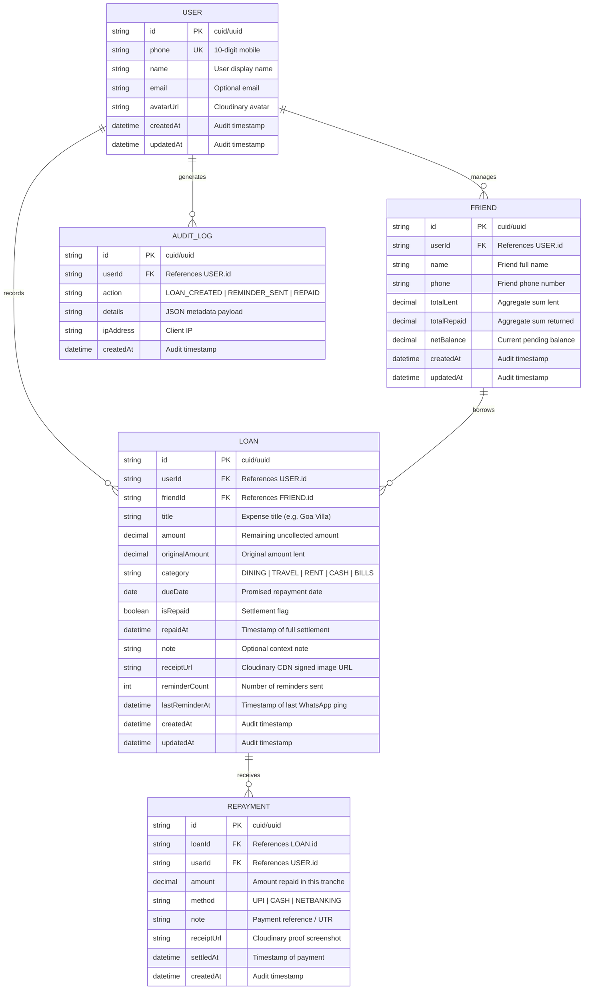

# 🗄️ DATABASE ENTITY-RELATIONSHIP (ER) MODEL: MiniLedger
Domain: Personal Micro-Lending (Credsetu Technologies)
Author: Pre-Backend Architecture & Database Specialist

---

## 🏛️ Visual Entity-Relationship Diagram

---

## 🔒 Relational Integrity & Indexing Invariants
1. **Compound Indexes**:
   - `LOAN`: `[userId, isRepaid, dueDate]` (Fast query for overdue / active dashboard items).
   - `FRIEND`: `[userId, name]` (Autocomplete friend search).
   - `REPAYMENT`: `[loanId, settledAt]` (Chronological repayment history).
2. **Zero In-Memory Mocking**:
   - Backed by real MongoDB Atlas / PostgreSQL cluster.
   - All mutations execute with strict ACID transactions to ensure `FRIEND.netBalance` and `LOAN.amount` stay perfectly reconciled.
3. **Receipt Cloudinary Isolation**:
   - `receiptUrl` stores signed Cloudinary CDN URLs (`https://res.cloudinary.com/thewebvale/...`). Zero local disk bloat.
