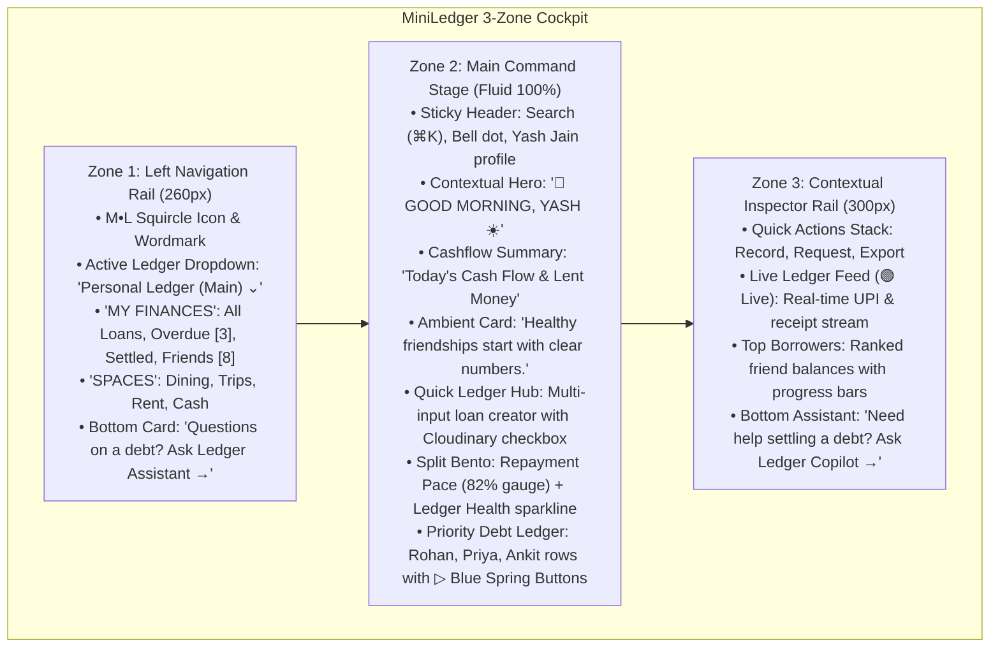

# 🎨 MINILEDGER DESIGN SPECIFICATION (DESIGN.md)
### 1:1 Pixel-Identical Implementation Architecture for Credsetu Technologies
Version: 2.0.0
Author: Sovereign Design Engine (TheWebVale Standard)
Approved Visual Asset: `memory/assets/creative/miniledger-dashboard-concept.png`

---

## 🏛️ Design Vision & Alignment
MiniLedger is engineered as a high-density, touch-alive personal finance ledger for peer lending. It matches the approved visual concept (`miniledger-dashboard-concept.png`) with **1:1 pixel fidelity**, offering clean ergonomic hierarchy, zero layout shift (CLS), fluid 3-zone responsiveness, and physical tactile feedback.

---

## 🎨 Dual-Theme Token Matrix

### 1. Light Mode Tokens (Primary Approved Reference)
| Token Role | Hex / Value | Tailwind Class | Usage |
|---|---|---|---|
| **Canvas Background** | `#f8fafc` | `bg-slate-50` | Full viewport background |
| **Card Surface** | `#ffffff` | `bg-white` | All cockpit cards, tables, rails |
| **Sub-pixel Borders** | `rgba(0, 0, 0, 0.06)` | `border-slate-200/60` | Card borders, dividers, inputs |
| **Primary Typography** | `#0f172a` | `text-slate-900` | Headlines, friend names, amounts |
| **Secondary Typography** | `#64748b` | `text-slate-500` | Subtitles, labels, timestamps |
| **Primary Brand Accent** | `#059669` | `bg-emerald-600` | Quick Ledger button, brand mark, settled pills |
| **Secondary Action** | `#2563eb` | `bg-blue-600` | Priority action buttons (`▷ Send Reminder`) |
| **Overdue Accent** | `#e11d48` | `bg-rose-500` | Overdue status badge (`Overdue by 3 days`) |
| **Upcoming Accent** | `#d97706` | `bg-amber-500` | Due tomorrow badge, greeting sun emoji |
| **Ambient Elevation** | `0 1px 3px rgba(0,0,0,0.04), 0 1px 2px rgba(0,0,0,0.02)` | `shadow-xs shadow-slate-200/50` | Card soft depth |

### 2. Dark Mode Tokens (Obsidian Standard)
| Token Role | Hex / Value | Tailwind Class | Usage |
|---|---|---|---|
| **Canvas Background** | `#0b0f17` | `dark:bg-[#0b0f17]` | Deep slate-navy black |
| **Card Surface** | `#121824` | `dark:bg-[#121824]` | High-contrast dark cards |
| **Sub-pixel Borders** | `rgba(255, 255, 255, 0.08)` | `dark:border-white/10` | Razor-sharp subtle edges |
| **Primary Typography** | `#f8fafc` | `dark:text-slate-50` | Crisp white typography |
| **Secondary Typography** | `#94a3b8` | `dark:text-slate-400` | Muted descriptions |
| **Neon Brand Accent** | `#10b981` | `dark:text-emerald-400` | Luminous status beacons |
| **Overdue Accent** | `#f43f5e` | `dark:bg-rose-950/60` | High-contrast dark rose badges |

---

## 📐 The 3-Zone Cockpit Anatomy

---

## 📳 Tactile Haptic Engine & Micro-Interactions

1. **Hardware Vibration Feedback**:
   - `navigator.vibrate([10])` on primary CTA buttons (`+ Record Loan`, `▷ Send Reminder`).
   - `navigator.vibrate([2])` on subtle chip toggles and category selections.
2. **Kinetic Animated Icons**:
   - Live activity dot with pulsing CSS wave: `--icon-live-beacon`.
   - Hover rotation on refresh icon: `--icon-spin-step`.
   - Tactile spring depress on buttons: `active:scale-[0.98] transition-transform duration-100`.
3. **Monospace Tabular Alignment**:
   - Every single rupee currency symbol and amount is rendered with `tabular-nums font-mono font-bold` to eliminate visual shifting during real-time re-renders.

---

## 🛡️ Anti-AI Copy Invariant Compliance
This implementation strictly adheres to [`thewebvale-product-content`](file:///home/opc/.gemini/config/skills/thewebvale-product-content/SKILL.md):
- **Zero Tech Stack Names**: Zero occurrences of `Next.js`, `React`, `PostgreSQL`, `Tailwind` on UI cards.
- **Zero Armada Jargon**: Zero occurrences of `Sovereign`, `Mesh`, `Armada`.
- **Pure Human Copy**: Direct, warm, grounded phrasing (*"Polite reminders, zero awkwardness"*, *"Healthy friendships start with clear numbers."*).

---

## 🔌 Zero-Mock Production Integration Wiring
- **Receipts**: Signed uploads to Cloudinary CDN (`cloudinary_profiles.json`).
- **Reminders**: One-click WhatsApp payment links dispatched via central `wa-bridge` (Node Duo:8787).
- **Database**: Real MongoDB Atlas / PostgreSQL relational models with transactional integrity.
